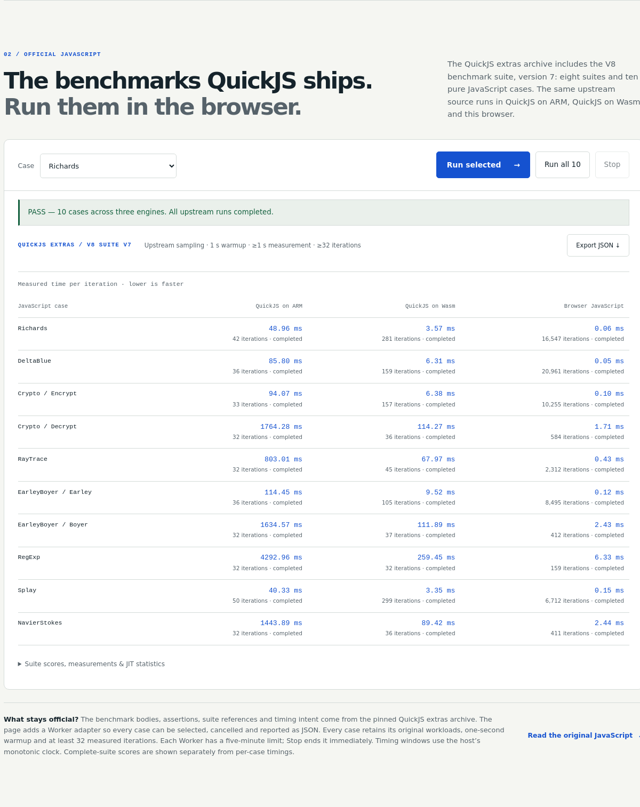
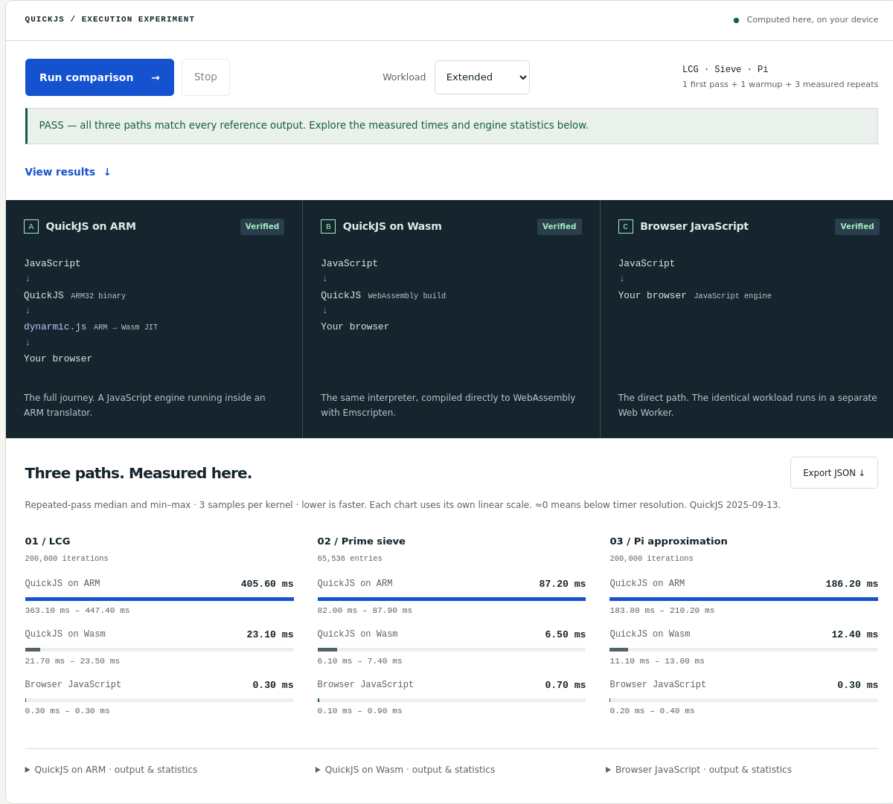

# JavaScript, inside QuickJS, inside an ARM guest

Run one JavaScript workload through three real execution paths:

1. QuickJS compiled to ARM32, executed by dynarmic.js.
2. The same QuickJS release compiled directly to WebAssembly.
3. The host JavaScript engine running the same source.

The [Pages lab](../browser/README.md) runs each path in a dedicated Web Worker.
This directory also provides a Node collector that checks all three paths and
prints their timings, workload outputs and dynarmic compilation statistics.

The Pages **Official benchmarks** lab also includes every JavaScript benchmark
shipped in QuickJS extras' V8 benchmark suite, version 7: Richards, DeltaBlue,
Crypto (Encrypt and Decrypt), RayTrace, EarleyBoyer (Earley and Boyer), RegExp,
Splay and NavierStokes. All eight suites and ten cases are selectable separately
or together. Each path executes the same pinned source and its original
benchmark algorithms, setup, teardown and existing assertions.



This view renders the recorded local Chromium measurements in the final page
layout. It is a measurement snapshot, not a published performance claim.

```sh
node examples/quickjs/official-run.mjs build-em/examples/browser/dist \
  --runtime all --case all --report test-results/official-v8/all.json
node examples/quickjs/official-run.mjs build-em/examples/browser/dist \
  --runtime dynarmic --case Splay/Splay --timeout 180000 \
  --report test-results/official-v8/splay.json
```

The official collector runs one case at a time in a fresh Worker and writes a
report after every result. A fault or the default 600-second per-case deadline
produces an explicit failed result and a failing exit status. No benchmark is
silently skipped. The report identifies the Node version, platform, loading
time, execution time, actual Wasm memory size and ARM compilation statistics.

The V8 v7 harness performs one warmup lasting at least **one second**, then
one-second measurement batches until it has executed at least **32 iterations**.
The page and collector call the original `RunStep` and `RunSingleBenchmark`.
Only their two `Date` timing expressions use the host's monotonic clock. The
reported time is total measured milliseconds divided by total iterations;
individual batch totals and counts are retained. Each case normally yields
one such aggregate observation, not three independent samples. Minimum and
maximum of a single observation do not measure variability.

A complete suite's score is `100 × reference / geometric_mean(case times in
microseconds)`. Crypto and EarleyBoyer each need both of their case results;
an individual row has no complete-suite score. Running Decrypt alone prepares
one Encrypt result outside timing, since the original suite supplies that
input by running Encrypt first. Running Encrypt alone performs a Decrypt
roundtrip outside timing to retain the suite's correctness check. The original
deterministic random generator is initialized anew with each Worker. Existing
upstream checks remain active, including Splay's teardown checks; RegExp and
NavierStokes do not contain numerical output assertions, so completion is not
an independent correctness oracle for those cases.

The official lab loads a separate `arm_bench_jit.js`/`.wasm` host with **256 MiB
guest RAM** and initially **384 MiB Wasm memory**. Both QuickJS paths have a
**192 MiB allocation limit**. Splay's unmodified 8,000-node workload requires
more than a 128 MiB allocation limit in this embedding. These assets load only
when running an official benchmark. The original LCG/sieve/pi lab and its
16 MiB guest host retain their smaller allocation.

`official-v8-upstream.js` preserves the complete original combined source and
its licenses. `official-v8.js` contains that source with the CLI auto-run
removed and the two clock substitutions; `official-v8-adapter.js` selects
cases and captures the original harness results. `official-benchmarks.json`
records the complete inventory, methodology and archive hash. The pinned
`quickjs-extras-source.tar.xz` ships alongside the source so these adaptations
can be inspected and rebuilt. `quickjs-extras-LICENSE.txt` supplies the complete
GPL 2.0 text for DeltaBlue, whose upstream notice is GPL-2.0-or-later; the other
benchmark sources retain their own notices. External C benchmark runners are
not part of this browser lab.



The screenshot is one local Extended run, not a published performance claim.
Use **Run comparison** to measure your own browser.

## Build locally

Build `browser_page` using the [browser guide](../browser/README.md). Its
`quickjs_example` dependency builds this example automatically. The first build
downloads the fixed upstream QuickJS source archive, checks its SHA-256 and
caches it. Subsequent builds work offline from that verified archive.

To build only the QuickJS artifacts after building the `arm_jit` host:

```sh
source /path/to/emsdk/emsdk_env.sh
python3 examples/quickjs/build.py --dist build-em/examples/browser/dist
node examples/quickjs/run.mjs build-em/examples/browser/dist light
node examples/quickjs/run.mjs build-em/examples/browser/dist full
python3 examples/quickjs/reference.py
```

Requirements are Python 3.10+, Emscripten, `arm-none-eabi-gcc`,
`arm-none-eabi-objcopy`, and newlib for ARM. On Debian/Ubuntu the guest tools are
in `gcc-arm-none-eabi`, `binutils-arm-none-eabi`, `libnewlib-arm-none-eabi` and
`libnewlib-dev`. The browser host has its own [build dependencies](../../docs/GettingStarted.md).
The builder accepts `--emcc`, `--arm-cc`, `--arm-objcopy` and `--cache` overrides.
Redistributed newlib copyright notices must match the installed toolchain; see
`runtime_notices.py` for the default location and override.

The Node command exits unsuccessfully on any runtime fault, wrong output,
invalid sample, incorrect warmup/sample count, or invalid guest exit status.
Its JSON identifies Node and the host platform. Those numbers describe Node,
not a browser. Use the Pages lab for browser measurements.

## Compare ARM compiler settings

For an end-to-end x86 comparison, the [v86 measurement harness](v86/README.md)
builds the same QuickJS embedding as a bare-metal multiboot guest and compares
all ten official cases in Chromium with paired, repeated measurements.

The [2026-10-31 investigation](../../docs/QuickJSArmTuning.md) tested 16
configurations and retained the original default. O2/Thumb/switch reduced the
guest binary by 24.97%, but its three complete Node rounds had an eight-suite
paired speedup median of 0.994× (range 0.919–1.013×), with consistent Richards
and Crypto/Decrypt regressions. Thumb remains an optional size tradeoff;
neither O3, LTO nor computed goto established a stable overall improvement.

The default remains **O2, ARM instructions, switch dispatch, no LTO**. These
six optional build flags affect only the ARM guest; direct QuickJS Wasm stays
at O2 with switch dispatch:

| Option | CMake cache variable | Default | Effect |
| --- | --- | --- | --- |
| `--arm-opt O2\|O3\|Os` | `DYNARMIC_QUICKJS_ARM_OPT` | `O2` | Select the ARM compiler optimization level. |
| `--arm-dispatch switch\|threaded` | `DYNARMIC_QUICKJS_ARM_DISPATCH` | `switch` | Select switch or computed-goto dispatch without changing the other platform features. |
| `--arm-lto` | `DYNARMIC_QUICKJS_ARM_LTO` | `OFF` | Enable ARM link-time optimization. |
| `--arm-isa arm\|thumb` | `DYNARMIC_QUICKJS_ARM_ISA` | `arm` | Select the C code's instruction set; startup stays ARM with linker interworking. |
| `--arm-no-gcse` | `DYNARMIC_QUICKJS_ARM_NO_GCSE` | `OFF` | Add only `-fno-gcse`; GCC's other merging passes keep their defaults. |
| `--arm-no-crossjumping` | `DYNARMIC_QUICKJS_ARM_NO_CROSSJUMPING` | `OFF` | Add only `-fno-crossjumping`; other tail-merging passes keep their defaults. |

For a separate Pages build, configure these settings in its own CMake build
directory. This example explicitly retains all six defaults; boolean options
accept `ON` or `OFF`:

```sh
emcmake cmake -S . -B build-quickjs-cmake-example -DCMAKE_BUILD_TYPE=Release \
  -DBoost_INCLUDE_DIR=/path/to/boost-headers \
  -DDYNARMIC_JS_EXAMPLES_REQUIRE_GUESTS=ON \
  -DDYNARMIC_QUICKJS_ARM_OPT=O2 \
  -DDYNARMIC_QUICKJS_ARM_DISPATCH=switch \
  -DDYNARMIC_QUICKJS_ARM_ISA=arm \
  -DDYNARMIC_QUICKJS_ARM_LTO=OFF \
  -DDYNARMIC_QUICKJS_ARM_NO_GCSE=OFF \
  -DDYNARMIC_QUICKJS_ARM_NO_CROSSJUMPING=OFF
```

CMake gives each build directory its own QuickJS cache. For compiler comparisons
that require byte-identical fixed inputs, use the shared-cache sequence below.

Use new directories for each candidate and retain a complete baseline. Build
variants **sequentially using the same cache path**, then stop compilation
before collecting measurements. QuickJS embeds source paths in assertions;
changing the cache path can change direct Wasm bytes even with identical flags.
This example prepares an experimental O3/threaded/LTO candidate, not a selected
or recommended winner:

```sh
mkdir build-quickjs-tuning-example
cp -a build-em/examples/browser/dist build-quickjs-tuning-example/baseline
cp -a build-em/examples/browser/dist build-quickjs-tuning-example/candidate
python3 examples/quickjs/build.py \
  --dist build-quickjs-tuning-example/baseline \
  --cache build-em/examples/browser/quickjs-cache
python3 examples/quickjs/build.py \
  --dist build-quickjs-tuning-example/candidate \
  --cache build-em/examples/browser/quickjs-cache \
  --arm-opt O3 --arm-dispatch threaded --arm-lto
node examples/quickjs/tune-arm.mjs \
  --variant baseline=build-quickjs-tuning-example/baseline \
  --variant candidate=build-quickjs-tuning-example/candidate \
  --baseline baseline --cases screen --repeats 1 \
  --output test-results/quickjs-tuning-example/screen
node examples/quickjs/tune-arm-analyze.mjs \
  test-results/quickjs-tuning-example/screen \
  --output-prefix test-results/quickjs-tuning-example/screen-analysis
```

The collector verifies that both Dynarmic hosts (`arm_jit` and
`arm_bench_jit`), direct QuickJS Wasm, official benchmark sources, adapters,
inventory and kernel source have identical hashes across variants. Only the
ARM guest may change. `quickjs-manifest.json` records each target's settings in
`configuration.targets`; `flags.armEffective` and `flags.wasmEffective` are the
complete compiler flags to use when checking what was actually built.

One screen round cannot establish an improvement. Confirm shortlisted settings
against the baseline with repeated fresh processes over **all ten official
cases**, retaining the full kernels as an additional check:

```sh
node examples/quickjs/tune-arm.mjs \
  --variant baseline=build-quickjs-tuning-example/baseline \
  --variant candidate=build-quickjs-tuning-example/candidate \
  --baseline baseline --cases all --repeats 3 \
  --output test-results/quickjs-tuning-example/confirmation
node examples/quickjs/tune-arm-analyze.mjs \
  test-results/quickjs-tuning-example/confirmation \
  --output-prefix test-results/quickjs-tuning-example/confirmation-analysis
```

Review per-case regressions, paired repeat variability, complete-call time,
compiled blocks and emitted bytes alongside the eight-suite aggregate. The
collector rotates variant order and retains raw reports; an interrupted run
can use `--resume` with exactly the same arguments and unchanged inputs.
Analysis writes JSON, Markdown and CSV to a new output prefix. See the
[ARM tuning protocol](../../docs/QuickJSArmTuning.md) for the research and
measurement criteria. Browser validation is still required before changing
the published configuration.

## One workload, known answers

[`workloads.js`](workloads.js) is copied unchanged to the page and embedded
byte-for-byte in both QuickJS binaries. It exposes
`QuickJSBench.run('light' | 'full', monotonicClock)` and contains three kernels:

| Kernel | Light | Full | Definition |
| --- | ---: | ---: | --- |
| LCG | 20,000 steps | 200,000 steps | 32-bit `Math.imul` recurrence with XOR mixing |
| Sieve | Primes below 8,192 | Primes below 65,536 | Eratosthenes over `Uint8Array` |
| Pi | 20,000 terms | 200,000 terms | FP64 Leibniz series, truncated after scaling by 1,000,000 |

| Profile | LCG result | Prime count | Pi × 1,000,000 |
| --- | ---: | ---: | ---: |
| Light | 2,778,886,796 | 1,028 | 3,141,542 |
| Full | 428,440,788 | 6,542 | 3,141,587 |

Every invocation verifies these fixed values, including discarded warmups.
[`reference.py`](reference.py) checks the constants independently with Python
integer arithmetic, trial division for primes, and a 50-digit Decimal sum for
pi. These workloads use the same algorithms as the original C demo with smaller
iteration counts suitable for JavaScript interpretation through an ARM guest;
the C and JavaScript timing totals must not be compared as equivalent work.

Each kernel records its first call, discards one further warmup, and retains
three samples. The report contains the raw samples, median, mean, minimum,
maximum and population standard deviation. A fresh QuickJS context is used for
each complete benchmark run. Within that run the context and dynarmic code
cache are reused, so the three measured samples are warm. The first call to a
kernel is not a fully cold engine: engine initialization and earlier kernels
may already have compiled shared interpreter paths. Script parsing, reporting
and engine setup are outside kernel samples. The separate complete-call time
includes interpreter/context creation, JavaScript parsing, all passes, reporting
and cleanup for both QuickJS paths. For direct browser JavaScript, source import
and parsing happen during preparation; its call time covers the passes and
statistics without interpreter setup. These totals have different setup work;
use the per-kernel samples to compare identical timed work.

The browser's exported JSON includes both the QuickJS build manifest and the
Dynarmic host build record, including revisions, compiler configuration and
runtime file hashes. It also retains the runtime order, workload parameters,
raw samples and visibility changes.

The samples are deliberately short. Browser timer precision and host load can
make fast JavaScript results noisy or zero; zero means below clock resolution,
not zero computation. Three samples are a local demonstration, not a broad
performance claim. See the [performance protocol](../../docs/Performance.md).

## Embedding details

The guest is an ARMv7-A flat binary at `0x10000` with an initial stack at
`0xff0000`. Its bounded newlib heap ends at `0xe00000`. Before running it, write
`0` (light) or `1` (full) as a little-endian 32-bit word at guest address
`0xf000`. It uses the existing host's SVC console, exit and microsecond clock.
The wrapping clock is extended in the runner. Check both the normal halt reason
and guest register R0 (zero on success). No OS or ELF loader is involved.

The direct Wasm module exports factory `createQuickJS`, function
`_qjs_bench(profile)` and `HEAPU8`. Its `print` callback receives one JSON line.
Return value zero means success. Invalid profiles are rejected. The runner does
not expose filesystem, network, shell, or module loading APIs. The page loads
only its pinned, bundled workload sources. The page terminates Workers on cancellation and timeout.
An allocation-tracking host sets an 8 MiB QuickJS allocation limit on both
targets without relying on platform-specific `malloc_usable_size` behavior.

Both targets use Bellard QuickJS **2025-09-13**. The default configuration uses
`-O2`, `-fwrapv`, `-fno-strict-aliasing`, and portable switch interpreter dispatch
on both targets; the ARM tuning options above can vary the guest build. Defining
QuickJS's `EMSCRIPTEN` platform mode on both targets disables Atomics and its
native stack checks. The three demo kernels are fixed and non-recursive; the official suite also
exercises recursion. Neither embedding is an arbitrary untrusted-JavaScript
sandbox. Both targets receive an identical
UTC-only timezone adaptation because bare-metal newlib lacks `tm_gmtoff`.
The adaptation does not affect these kernels. ARM uses newlib/libgcc; direct
Wasm uses the Emscripten C runtime, so instruction sets and platform libraries
still differ. The manifest records the actual toolchain versions and flags.

The official JS path also exports `_qjs_set_memory_limit(bytes)` and
`_qjs_eval(pointer, length)` (plus `_malloc`/`_free`). The latter accepts the
NUL-terminated bundled script and prints its final JSON string. Both builds use
the same evaluator and allocator. The ARM mailbox at `0xf000` selects this path
with six little-endian words: `[2, sourceAddress, sourceLength, memoryLimit,
ramSize, stackTop]`. The page places source at `ramSize - 8 MiB` (under 4 MiB),
bounds the heap below it, and starts the stack at `ramSize - 64 KiB`. These are
host-controlled addresses for the shipped sources, not a public sandbox ABI.

## Source and distribution

`quickjs-manifest.json` binds every runtime artifact to its hash, size, local
source files and upstream source checksum. `quickjs-source.tar.xz` preserves
the complete pristine upstream source. `build.py` applies its small platform
adaptation explicitly, then builds both targets from that source. The archive,
QuickJS MIT license and newlib/libgcc notices ship in the Pages distribution.
The source packager checks the manifest before packaging the complete project.
The generated `source-manifest.json` records all six actual ARM options in
`rebuild.cmakeCacheOptions` and includes them in its rebuild command. Use those
recorded settings to reproduce a non-default guest; rebuilding only with the
current defaults would lose the selected compiler configuration.

Upstream source: <https://bellard.org/quickjs/quickjs-2025-09-13-2.tar.xz>

SHA-256: `996c6b5018fc955ad4d06426d0e9cb713685a00c825aa5c0418bd53f7df8b0b4`.
