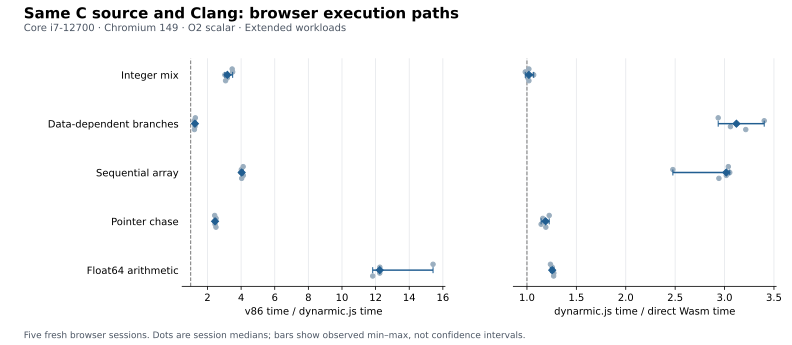

# C execution paths — measured 2026-10-31

Fresh performance collection of the new Pages C benchmark. On this Intel Core i7-12700 workstation, Chromium **149.0.7827.55**, the equal-case geometric ratio favors dynarmic.js over v86 by **3.39×**. dynarmic.js takes **1.69×** the direct-Wasm time across these five scalar kernels. These are complete-path measurements for this fixed workload, not universal emulator or application performance claims.

All three targets use **Clang 22.1.8 from Zig 0.17.0**, scalar O2, the identical C source and inputs, no libc, no vectorization/unrolling, no fast-math or FP contraction. Each data address space is 16 MiB; total emulator Wasm memory capacities differ and are retained. ARM is ARMv7-A/VFPv3; x86 uses SSE2. v86 is the pinned release 0.5.473+g315b2b0. ARM host profiling and diagnostics are off.

## Repeated execution

Unit: milliseconds per full fixed workload. Times are the median of five browser-session medians; each session median summarizes its three round medians, each from three measured calls after the first call and two warmups. Ratios are paired within rounds before taking session and final medians, so dividing displayed time medians may yield a different value.

| Case | Iterations per call | dynarmic.js ms | v86 ms | Direct Wasm ms | v86 / dynarmic | dynarmic / Wasm |
| --- | ---: | ---: | ---: | ---: | ---: | ---: |
| integer | 16,000,000 | 26.40 | 82.40 | 25.30 | 3.18× | 1.02× |
| branch | 4,000,000 | 42.30 | 53.50 | 13.80 | 1.25× | 3.12× |
| stream | 32,000,000 | 52.60 | 214.20 | 17.80 | 4.03× | 3.02× |
| pointer | 16,000,000 | 26.80 | 66.10 | 22.90 | 2.45× | 1.19× |
| float | 16,000,000 | 22.80 | 276.90 | 18.00 | 12.25× | 1.26× |

The five session-level overall v86/dynarmic ratios are **3.56, 3.35, 3.39, 3.42, 3.38×** (median 3.39×; range **3.35–3.56×**). The dynarmic/direct-Wasm ratios are **1.69, 1.59, 1.72, 1.68, 1.71×** (median 1.69×; range **1.59–1.72×**). These ranges describe five session summaries, not confidence intervals.



## First call and preparation

The first kernel call may include translation and browser tiering; it is not a fully cold browser startup. Preparation includes loading, hash verification, instantiation and host setup. All values below are separate hierarchical medians, in milliseconds, and must not be added to the repeated-call figures.

| Case | ARM first / prepare | x86 first / prepare | Wasm first / prepare |
| --- | ---: | ---: | ---: |
| integer | 31.3 / 32.2 | 97.5 / 36.4 | 36.3 / 4.5 |
| branch | 50.3 / 33.2 | 77.2 / 37.6 | 21.6 / 4.8 |
| stream | 60.9 / 31.5 | 217.2 / 39.6 | 38.9 / 4.7 |
| pointer | 32.2 / 32.8 | 82.9 / 36.6 | 23.5 / 4.8 |
| float | 29.1 / 32.9 | 293.7 / 37.1 | 30.7 / 5.1 |

## Method and retained failures

The primary experiment has **five fresh Chromium processes/profiles**, each executing the ordinary Pages Extended run: five cases × three runtimes × three rounds. Each observation uses a fresh Worker/module/emulator with six checksummed calls. **225 observations, 675 measured calls, and all 1,350 checksums passed**. Runtime order rotates through all three positions inside each session. The outer repetition unit is the browser session; inner calls are not independent experiments.

CPU affinity was fixed to logical CPUs **8,10,12,14**. No compilation or other benchmarks were launched concurrently by this task, but the workstation was not exclusive. The same input and script hashes were checked before and after each session. Browser version, host/compiler manifests, memory capacities, raw warmup curves and load averages are retained. Two warmups are not a universal steady-state guarantee.

An earlier attempt with installed **Chrome 133.0.6943.53** completed only **one of five** sessions; four sessions ended with `Runtime.evaluate` control-channel timeouts. Their cause was not established here. The complete attempt, including the sole successful session, is retained in `chromium133-incomplete-raw.tar.gz` and `measurement.log`. It is excluded from the primary timing summary. The benchmark inputs and protocol were not changed when the experiment was restarted from scratch with the installed Chrome-for-Testing 149 binary. All five Chrome 149 sessions completed without retry.

These simple scalar kernels do not reproduce QuickJS interpreter dispatch, allocation or regular-expression behavior. Do not treat the difference from an earlier QuickJS measurement as an emulator optimization or directly combine results across workloads/browser versions. The memory kernels operate over 8,192 words (32 KiB); they are not general DRAM-bandwidth tests.

## Reproduce

Build `browser_page` as described in [the C benchmark guide](../../../examples/c-bench/README.md), then run the page collector using a chosen browser version:

```sh
taskset -c 8,10,12,14 node examples/c-bench/measure.mjs \
  --browser /path/to/chrome --dist build-em/examples/browser/dist \
  --sessions 5 --output NEW_RESULTS_DIRECTORY
python3 internals/measurements/2026-10-31-c-bench-performance/analyze.py \
  NEW_RESULTS_DIRECTORY NEW_ANALYSIS_DIRECTORY
```

`chromium149-raw.tar.gz` contains the immutable experiment and all five raw page reports. `samples.csv` retains each round median, first call, preparation and inner samples; `summary.json` retains every session-level aggregate. `analyze.py` and `plot.py` regenerate the summary and plots. The collector and checked scripts are identified by hashes in the experiment.

An independent recomputation from the raw reports matches all timing and ratio
aggregates; see `independent-review.json`. All measured bytes remain unchanged.
The integer ARM/Wasm session ratios span 0.983–1.068×, so that case does not
establish a consistent winner. The float v86/ARM range is wider, 11.827–15.417×.
