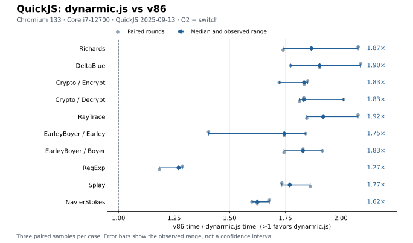

# QuickJS: dynarmic.js versus v86 — 2026-10-31

On this Core i7-12700 workstation with Chromium 133, dynarmic.js + QuickJS took less time in all ten official V8 v7 cases. The median of three paired, equal-weight eight-suite ratios is **1.73×** in favor of dynarmic.js (rounds: **1.78×, 1.73×, 1.70×**). This describes completed benchmark executions; browser interruptions and restart costs are excluded.

Times below are each runtime’s three-sample median in milliseconds per official invocation. Ratios are calculated within each pair first, then summarized across rounds, so they need not equal the quotient of the displayed timing medians. Ranges are observed min–max, not confidence intervals.

| Benchmark | dynarmic.js ms | v86 ms | Paired ratio | Ratio range |
| --- | ---: | ---: | ---: | ---: |
| Richards | 53.5 | 93.1 | 1.87× | 1.74–2.08× |
| DeltaBlue | 87.3 | 166.2 | 1.90× | 1.77–2.09× |
| Crypto/Encrypt | 93.5 | 171.0 | 1.83× | 1.72–1.85× |
| Crypto/Decrypt | 1763.1 | 3249.7 | 1.83× | 1.81–2.01× |
| RayTrace | 807.5 | 1550.5 | 1.92× | 1.85–2.08× |
| EarleyBoyer/Earley | 112.9 | 204.4 | 1.75× | 1.40–1.84× |
| EarleyBoyer/Boyer | 1625.2 | 3090.2 | 1.83× | 1.74–1.92× |
| RegExp | 4357.3 | 5469.9 | 1.27× | 1.18–1.29× |
| Splay | 40.3 | 74.8 | 1.77× | 1.73–1.86× |
| NavierStokes | 1445.6 | 2347.8 | 1.62× | 1.60–1.68× |

## Configuration and timing

Both paths use the identical QuickJS **2025-09-13** interpreter source, **O2**, switch dispatch, no LTO, the same EMSCRIPTEN feature guards and UTC adaptation, and the same allocator/evaluator code. Both have **256 MiB guest RAM** and a **192 MiB QuickJS allocation limit**. The official benchmark source and adapter hashes match.

| Component | dynarmic.js | v86 |
| --- | --- | --- |
| Guest | Bare-metal ARMv7-A, ARM state, VFPv3, softfp | Bare-metal i386/Pentium 4 multiboot ELF, SSE2 C arithmetic |
| C compiler | ARM GCC 10.3.1 | GCC 11 multilib |
| C runtime | Installed ARM newlib 3.3.0 | Locally built x86 newlib 3.3.0 |
| Emulator | Existing Release arm_bench_jit, profiling/diagnostics off | Official npm 0.5.473+g315b2b0, Release v86.wasm, default JIT enabled |

The x86 binary retains the standard i386 ABI, including some x87 returns and newlib assembly. No fast-math or benchmark-size reduction was used. ISA, compiler versions, libc builds, ABI, JIT strategy and scheduling differ, so this is a comparison of the two complete QuickJS execution paths, not an isolated ranking of emulator instruction throughput.

Both guest timers read host `performance.now()` as wrapping microseconds with the same extension logic. v86 uses normal asynchronous `run()` scheduling so generated Wasm can finish compiling; no synchronous loop or virtual guest time substitutes for real elapsed time. The original harness retains its one-second warmup, one-second measurement batches and minimum 32 calls, with all original checks. RegExp and NavierStokes contain no independent numerical result assertion.

Every observation uses a fresh Worker and emulator. Runtime order alternates within each case across logical rounds, and case order rotates. CPU affinity was `8,10,12,14` on a shared, non-exclusive machine. Each round first combines the two Crypto and two EarleyBoyer cases geometrically, then weights the eight suites equally. The secondary, ten-case equal-weight median ratio is **1.76×**. Preparation and whole-call durations are retained separately; adaptive iteration counts mean whole-call times do not represent equal work.

## Interruptions and recovery

There were **63 task starts: 61 completed pass reports and two browser-control interruptions**. One completed, unpaired Richards/dynarmic observation was retained under `superseded/` and replaced by rerunning both members together after restarting Chromium. The final DeltaBlue pair was also run together after another interruption. The primary analysis therefore has **60 valid observations / 30 same-process pairs**. No result was silently overwritten or selected because it was faster.

The actual execution used **three logical rounds and five Chromium processes**: the third logical round spans three processes, while each individual case pair remains within one process. Both interruptions appeared as `Runtime.evaluate` control timeouts. The latest OS crash report confirms a benchmark Chromium renderer received SIGSEGV; its cause, and whether both interruptions shared that cause, were not established. These results are not a stability comparison and do not charge unsuccessful attempts or browser restarts to either timing column.

Original interruption logs, both recovery records, the retained superseded observation and sanitized crash metadata are included in `raw-results.tar.gz`. The immutable original experiment plan describes the uninterrupted schedule; this recovery history describes what actually happened.

## Reproduction and evidence

- [Build and run instructions](../../../examples/quickjs/v86/README.md).
- [Full analysis](comparison.md), [CSV](comparison.csv), [JSON](comparison.json).
- `raw-results.tar.gz`: complete plan, manifests, all primary observations, browser-attempt metadata, logs, recovery records and the superseded sample.
- `build-and-sources.tar.gz`: measured collector/Worker/builder source snapshots, newlib build logs and the hosted-compiler adjustment record.
- `quickjs-x86-manifest.json`, `quickjs-manifest.json`, `arm-bench-build-manifest.json`, `comparison-inputs.json`: actual compiler settings, versions, source and executable hashes.
- `validation.json`: independent recomputation of all suite ratios and validation that all 30 pairs share one browser attempt; all frozen input hashes still match.
- `kernel-validation-node.json`: the final x86 guest passed the independent full LCG/sieve/pi reference outputs. This Node smoke result is not included in the browser performance analysis.
- `plot.py`: regenerates the SVG/PNG from the archived JSON using Matplotlib.

All original benchmark inputs and runtime files remained fixed during collection. The comparison harness is separate from the public Pages UI. These measurements and checks were collected before committing this change. No deployment was performed.

After collection, the tools were hardened to reject cross-browser pairs and to
require explicit preservation of an interrupted half-pair before resuming.
The reviewed analysis now carries the recovery metadata directly; its numeric
results are identical to the original analysis. The original measured
collector remains in `build-and-sources.tar.gz`, matching the experiment hash.

The final 65 protocol/UI tests, workflow lint and shell/Python syntax checks
passed. Additional license copies in prepared bundles preserve all 18 measured
input files byte for byte.
